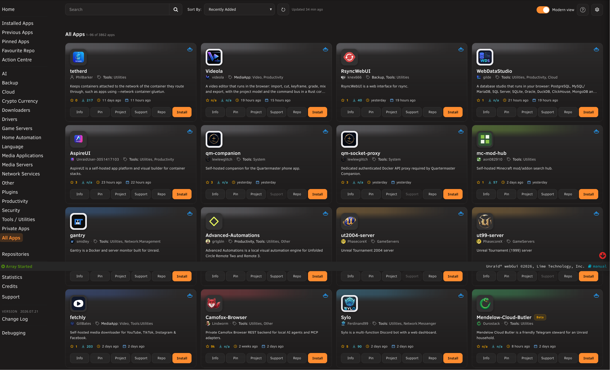
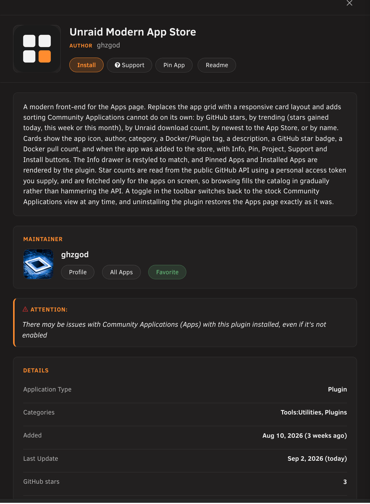

# Unraid Modern App Store

A modern front-end for the Unraid **Apps** page. It replaces Community Applications' grid with a responsive card layout and adds the sorting CA cannot do on its own: **GitHub stars**, **trending** (stars gained in the past 24 hours / 7 days / 30 days / past year / all time, plus a Rising sort), **Unraid downloads**, **newest to the App Store**, or name.

It never modifies Community Applications. Everything is layered on top and scoped to this plugin's own markup, so switching the view off, or uninstalling, returns the Apps page to stock.

## Screenshots





## Requirements

- Unraid 6.12 or newer with the **Community Applications** plugin installed.
- A GitHub **personal access token** (free) for star counts. Use a **classic** token (`ghp_...`) with **no scopes**; it only reads public data. Without one the grid still works, minus the star badges.

  A **fine-grained** token (`github_pat_...`) works too, since star counts and the trending windows need nothing a classic token has.

## Install

Plugins → Install Plugin, paste:

```
https://raw.githubusercontent.com/ghzgod/unraid-modern-appstore/main/modern.appstore.plg
```

Then set your token at **Settings → Utilities → Unraid Modern App Store**.

## What you get

- **A card grid** with the app icon, maintainer, categories and a three-line description. The strip across the top of each card is tinted in the app's own icon colour and carries the app's facts: GitHub stars, Docker pulls, last update and the date it was added to the store, each with its own colour. Unraid, Official, Beta, Privileged and Not compatible apps are flagged beside the name, and incompatible apps can be hidden from Settings.
- **Maintainer standing** beside every maintainer's name: how many templates they publish and the GitHub stars across them.
- **Pull counts** are dropped for apps built on an official base image (nginx, redis, postgres), where the figure belongs to the base image rather than the app.
- **Sorting that works across the whole catalog**, with real pagination, search and category filtering.
- **Pinned Apps** and **Installed Apps** rendered by the plugin.
- **A restyled Info drawer**, with the description, details and maintainer as one column of cards, and a built-in screenshot lightbox. The maintainer's own drawer lists their apps as the same cards the store uses.
- **A Modern view toggle** in the toolbar to hand the page back to Community Applications at any time.
- **Cards per row** is a setting (2 to 6, default 3). A narrower window shows as many as fit.

## How the trending windows work

Every trending sort ranks by GitHub stars and differs only in the window it measures.

| Sort | Ranks by |
| --- | --- |
| Most Stars Gained (past 24 hours / 7 days / 30 days) | Stars gained in that window |
| Most Stars Gained (past year) | Stars gained in the last 365 days, or since this install began recording if that is shorter |
| Most Stars Gained (all time) | Every star the repo has ever gained |
| Fastest Growing (past 24 hours / 7 days / 30 days) | That gain over the star count at the window's start |
| Fastest Growing (past year) | The past year's gain over the star count at the start of the window |
| Fastest Growing (all time) | Lifetime rate: total stars over the repo's age in years |
| Rising (past 7 days) | The past 7 days' daily pace over the pace of the 23 days before, for repos with at least 50 stars in the week |

Every window comes from the plugin's own daily star snapshots, taken only for repos fetched that day. A repo created inside a window needs no history, since every star it has was gained in that window. Until a full year of history exists, the past year window counts from when the plugin was installed.

Rising separates a project that is speeding up from one that is merely large: a repo gaining stars faster this week than over the three weeks before it ranks above a bigger one coasting at a steady pace.

"Trending % (all time)" is a rate rather than a percentage on purpose. The other percent sorts divide by the star count at the window's start, and at a repo's creation that is zero, so the lifetime average (stars per year of age) is used instead. It separates a project that gained 5,000 stars in two years from one that took twelve to gain 20,000.

One limit worth knowing: a star since removed leaves no trace in a later snapshot, so a window's gain can read slightly low.

## How star data is gathered

Stars come from the public GitHub API, keyed to each app's project repository. They are fetched for **the apps currently on screen**, so browsing fills the catalog in gradually; an app is only re-checked if it has never been tried or its last attempt is over a week old. The refresh icon offers a rescan of the current page, or a full catalog scan (limited to once every three days).

Community Applications publishes most project links as `ca.unraid.net/cdn/...` redirectors, so the plugin resolves each one to its real destination and caches the result. Requests to GitHub and other hosts carry a stock browser User-Agent, so nothing identifies the plugin or the server. That resolution is only for counting stars: the card's Project and Support buttons open the template's link exactly as the maintainer published it, the same as Community Applications does. Apps whose project link is a plain homepage rather than a repository have no star count, because there is no repository to count.

## What it writes

Only its own two directories:

- `/usr/local/emhttp/plugins/modern.appstore/`
- `/boot/config/plugins/modern.appstore/` (settings, the star database and its history)

Both are removed on uninstall. It never writes to any Community Applications path.

## Licence

MIT
